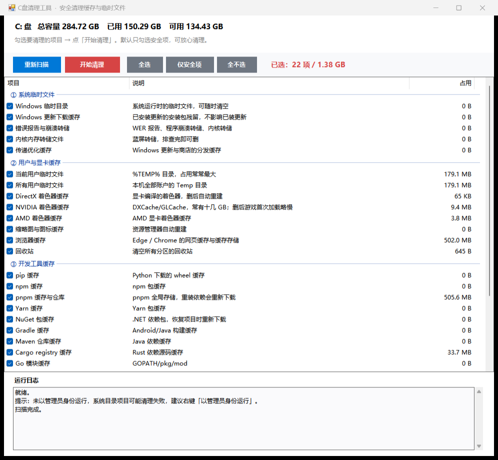

# C盘清理工具（C Cleaner for Windows）

一个 **35KB 单文件绿色版** Windows 磁盘清理工具，双击即用，无需安装、无需运行库。
只清理**可再生的缓存、临时文件与日志**，绝不碰系统关键目录。



## 特性

- **单文件，零依赖**：仅需 Windows 10 / 11 自带的 .NET Framework 4.8，拷到任何电脑双击就能跑
- **自动提权**：内嵌 `requireAdministrator` 清单，双击自动弹出 UAC
- **先扫描后清理**：每项先算出真实占用，勾选式操作，清理前后对比磁盘可用空间
- **28 个清理项，分四组**
  - ① 系统临时文件：Windows\Temp、更新下载缓存、错误报告与崩溃转储、传递优化缓存
  - ② 用户与显卡缓存：用户 Temp、DirectX/NVIDIA/AMD 着色器缓存、缩略图缓存、Edge/Chrome 缓存、回收站
  - ③ 开发工具缓存：pip / npm / pnpm / Yarn / NuGet / Gradle / Maven / Cargo / Go
  - ④ 需确认（有代价）：Windows.old、休眠文件、Prefetch、系统日志、Playwright、剪映缓存
- **安全优先**
  - 默认只勾选安全项，第 ④ 组默认不勾，勾选时日志区给出代价提示
  - 绝不触碰 `WinSxS`、`Windows\Installer`、`System32` 等不可再生内容
  - 被进程占用的文件自动跳过，不强删、不导致程序崩溃
  - 清理前二次确认

## 使用方法

1. 双击 `C盘清理工具.exe`，UAC 弹窗点「是」
2. 等待自动扫描完成（各项显示实际占用）
3. 按需勾选，默认已选好的安全项可直接用
4. 点「开始清理」→ 确认 → 完成后弹窗显示释放量

## 自检 / 只读模式

```
C盘清理工具.exe -selftest
```

生成 `selftest.txt`，列出各项目当前占用，**不做任何删除**。

## 从源码构建

源码为单文件 C# WinForms（C# 5 语法，兼容系统自带的编译器）：

```powershell
$csc = "C:\Windows\Microsoft.NET\Framework64\v4.0.30319\csc.exe"
& $csc /nologo /codepage:65001 /target:winexe /platform:anycpu /optimize+ `
      /win32icon:src\app.ico /win32manifest:src\app.manifest `
      /out:C盘清理工具.exe /r:System.dll /r:System.Windows.Forms.dll /r:System.Drawing.dll `
      src\CleanC.cs
```

或直接运行 `build.ps1`。

## 已知限制

- 「休眠文件」会执行 `powercfg /h off`（关闭休眠与快速启动），需要时用 `powercfg /h on` 恢复
- 「Windows.old」删除后**无法回滚**到旧系统
- 「Windows 更新下载缓存」不影响已安装的更新
- 正在被占用的文件会被跳过，属正常现象

## 许可

MIT License，见 [LICENSE](LICENSE)。
